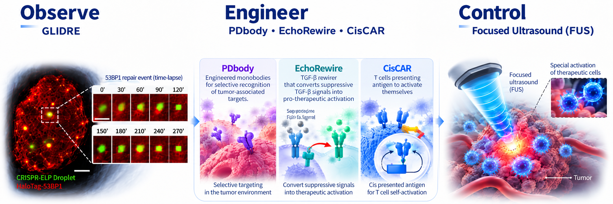

---
page-title: false
page-navigation: false
toc: false
page-layout: full
---

::: {.homepage-container}

:::: {.columns .hero-section}

::: {.column width="28%"}

{.profile-photo fig-alt="Portrait of Linshan Zhu"}

:::

::: {.column width="72%"}

# Linshan Zhu, Ph.D.

### Engineering Programmable Cellular Therapies

**Postdoctoral Researcher | University of Southern California**

I develop technologies that integrate synthetic biology, protein and cell engineering, quantitative imaging, and focused ultrasound to advance programmable cellular therapies.

My long-term goal is to create engineered biological systems that can be precisely measured, dynamically regulated, and externally controlled.

  <a href="mailto:linshanz@usc.edu">
    <i class="bi bi-envelope"></i> E-mail
  </a>

  <a href="https://www.linkedin.com/in/linshan-zhu-68632712a"
     target="_blank" rel="noopener noreferrer">
    <i class="bi bi-linkedin"></i> LinkedIn
  </a>

  <a href="https://orcid.org/0000-0003-3849-3237"
     target="_blank" rel="noopener noreferrer">
    <i class="ai ai-orcid"></i> ORCID
  </a>

  <a href="https://scholar.google.com/citations?user=sU-I7jgAAAAJ&hl=en"
     target="_blank" rel="noopener noreferrer">
    <i class="ai ai-google-scholar"></i> Google Scholar
  </a>

<a href="files/CV_Linshan%20Zhu.pdf"
   target="_blank" rel="noopener noreferrer">
  <i class="bi bi-file-earmark-person"></i> CV
</a>

:::

::::

## Research Overview

{.research-overview fig-alt="Overview of research in molecular imaging, synthetic biology, and focused ultrasound"}

:::: {.columns}

::: {.column width="33%"}

### 01. Observe

**Live-Cell Imaging & Biosensors**

Develop molecular imaging technologies to investigate cell signaling, chromatin dynamics, and DNA repair in living cells.

:::

::: {.column width="33%"}

### 02. Engineer

**Synthetic Biology & Immunoengineering**

Design programmable signaling circuits that enable therapeutic cells to overcome tumor-associated suppression.

:::

::: {.column width="33%"}

### 03. Control

**Focused Ultrasound & Cellular Therapies**

Engineer ultrasound-responsive biological systems for noninvasive spatiotemporal control of therapeutic cell functions.

:::
Explore all my major projects.

[View Research Projects →](projects.qmd)

::::

## Selected Publications
1. **Zhu L.**, Cui J., Man C.W., Mouchawar A., Yu X., Huang Y., Wu Y., Guo T., Xu H., et al. Ultrasound controllable and antigen-independent killing via cis-activating CAR T cells. Molecular Therapy Oncology. 2026. [link](https://www.cell.com/molecular-therapy-family/oncology/fulltext/S2950-3299(26)00199-2?_returnURL=https%3A%2F%2Flinkinghub.elsevier.com%2Fretrieve%2Fpii%2FS2950329926001992%3Fshowall%3Dtrue)
2. **Zhu L.**, Man C.W., Harrison R., Limsakul P., Peng Q., Hashimoto M., Mamaril A., Xu H., Wu Z., Liu L., Wang Y. Engineering a Programmed Death-Ligand 1-Targeting Monobody Via Directed Evolution for SynNotch-Gated Cell Therapy. ACS Nano. 2024. [link](https://pubs.acs.org/ancac3/article/18/11/8531/150501/Engineering-a-Programmed-Death-Ligand-1-Targeting)
3. **Zhu L.**, Wu Y., Yoon C.W., Wang Y. Mechanogenetics for cellular engineering and cancer immunotherapy. Current Opinion in Biotechnology. 2020. [link](https://www.sciencedirect.com/science/article/pii/S0958166920300811?via%3Dihub)
4. Zamat A., **Zhu L.**, Wang Y. Engineering Molecular Machines for the Control of Cellular Functions for Diagnostics and Therapeutics. Advanced Functional Materials. 2019. [link](https://advanced.onlinelibrary.wiley.com/doi/10.1002/adfm.201904345)

Explore all my publications in cellular engineering, molecular imaging, and programmable immunotherapies.

[View Publications →](publications.qmd)

## Academic Background

2023-present:    **Postdoctoral Researcher**, University of Southern California

2017-2022:       **Ph.D. in Bioengineering**, University of California, San Diego

2012-2016:       **Bachelor in Biotechnology**, University of Science and Technology of China

:::
