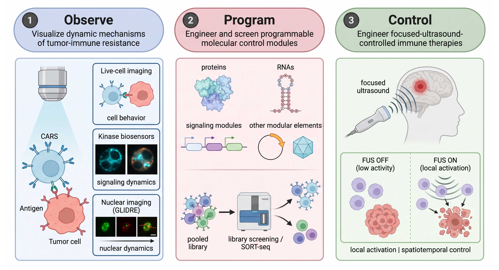

---
page-title: false
page-navigation: false
toc: false
page-layout: full
---

::: {.homepage-container}

:::: {.columns .hero-section}

::: {.column width="28%"}

{.profile-photo fig-alt="Portrait of Linshan Zhu"}

:::

::: {.column width="72%"}

# Linshan Zhu, Ph.D.

### Sonogenetic Cell Therapies: Control from Outside the Body

**Postdoctoral Researcher | University of Southern California | linshanz@usc.edu** 🌈

I develop technologies that integrate synthetic biology, protein and cell engineering, quantitative imaging, and focused ultrasound to advance programmable cellular therapies.

My long-term goal is to create engineered biological systems that can be precisely measured, dynamically regulated, and externally controlled, which can ultimately translate into clinic.

  <a href="https://www.linkedin.com/in/linshan-zhu-68632712a"
     target="_blank" rel="noopener noreferrer">
    <i class="bi bi-linkedin"></i> LinkedIn
  </a>

  <a href="https://orcid.org/0000-0003-3849-3237"
     target="_blank" rel="noopener noreferrer">
    <i class="ai ai-orcid"></i> ORCID
  </a>

  <a href="https://scholar.google.com/citations?user=sU-I7jgAAAAJ&hl=en"
     target="_blank" rel="noopener noreferrer">
    <i class="ai ai-google-scholar"></i> Google Scholar
  </a>

<a href="files/CV_Linshan%20Zhu.pdf"
   target="_blank" rel="noopener noreferrer">
  <i class="bi bi-file-earmark-person"></i> CV
</a>

:::

::::

## Research Overview

{.Observe fig-alt="ALL"}

:::: {.columns}

::: {.column width="33%"}

### 01. Observe

**Live-Cell Imaging & Biosensors**

Develop molecular imaging technologies to investigate cell signaling, chromatin dynamics, and DNA repair in living cells.

:::

::: {.column width="33%"}

### 02. Program

**Synthetic Biology & Immunoengineering**

Design programmable signaling circuits that enable therapeutic cells to overcome tumor-associated suppression.

:::

::: {.column width="33%"}

### 03. Control

**Focused Ultrasound & Cellular Therapies**

Engineer ultrasound-responsive biological systems for noninvasive spatiotemporal control of therapeutic cell functions.

:::

[**View Research Projects →**](projects.qmd)

::::

## Selected Publications

1. **Zhu L.**, Monther A., Mouchawar A.C., Huang Y., Tsoy M., Yu X., Dong X., Huang Z., Peng Q., Qu Y., Wu Y., Liu L., Wang Y.  
   **Programmable Imaging of Locus-Specific DNA Repair-Associated Dynamics Reveals Chromatin-Controlled Therapy Resistance in Cancer.**  
   *Manuscript under revision.*

2. Liu L.\*, **Zhu L.\***, Mouchawar A., Qu Y., Wu Z., Wang Y., Guo T., Chittle S., Nam C., Shao X., et al.  
   **Reprogramming Immunosuppressive Signals for Sustained Sonogenetic CAR T-cell Therapy.**  
   *Manuscript under revision.*

3. **Zhu L.\***, Cui J.\*, Man C.W., Mouchawar A., Yu X., Huang Y., Wu Y., Guo T., Xu H., et al.  
   [**Ultrasound controllable and antigen-independent killing via cis-activating CAR T cells**](https://doi.org/10.1016/j.omton.2026.201323).  
   *Molecular Therapy Oncology*. **2026**.

4. Qu Y., Wang Y., **Zhu L.**, Ma F., Yoon C.W., Chen X., Zhang J., Bishop C., Tang M., et al.  
   [**Identifying and reprogramming softness-driven cancer stem-like cells overcomes CAR-T cell resistance in solid tumours**](https://doi.org/10.1038/s41551-026-01722-7).  
   *Nature Biomedical Engineering*. **2026**.

5. Liu L., He P., Wang Y., Ma F., Li D., Bai Z., Qu Y., **Zhu L.**, Yoon C.W., Yu X., et al.  
   [**Engineering sonogenetic EchoBack-CAR T cells**](https://doi.org/10.1016/j.cell.2025.02.035).  
   *Cell*. **2025**.

6. **Zhu L.\***, Man C.W.\*, Harrison R., Limsakul P., Peng Q., Hashimoto M., Mamaril A., Xu H., Wu Z., Liu L.#, Wang Y.#  
   [**Engineering a Programmed Death-Ligand 1-Targeting Monobody Via Directed Evolution for SynNotch-Gated Cell Therapy**](https://doi.org/10.1021/acsnano.4c01597).  
   *ACS Nano*. **2024**.

7. **Zhu L.**, Wu Y., Yoon C.W., Wang Y.  
   [**Mechanogenetics for cellular engineering and cancer immunotherapy.** ](https://www.sciencedirect.com/science/article/abs/pii/S0958166920300811?via%3Dihub) 
   *Current Opinion in Biotechnology*. **2020**.

8. Zamat A.\*, **Zhu L.\***, Wang Y.  
   [**Engineering Molecular Machines for the Control of Cellular Functions for Diagnostics and Therapeutics.**](https://advanced.onlinelibrary.wiley.com/doi/10.1002/adfm.201904345)  
   *Advanced Functional Materials*. **2019**.

\* Equal contribution; # Corresponding author.

[**View Complete Publication List →**](publications.qmd)

## Academic Background

2023-present:    **Postdoctoral Researcher**, University of Southern California

2017-2022:       **Ph.D. in Bioengineering**, University of California, San Diego

2012-2016:       **Bachelor in Biotechnology**, University of Science and Technology of China

:::
