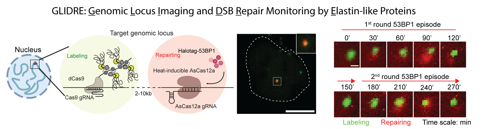
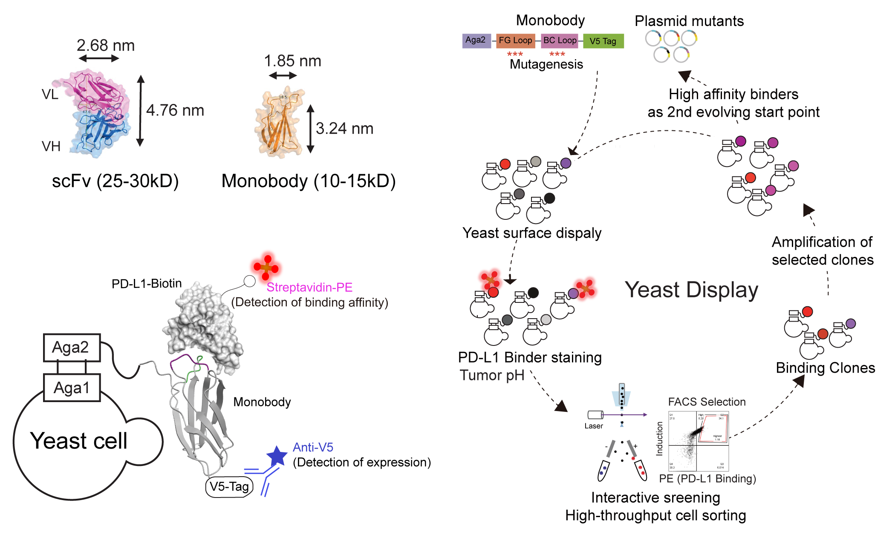
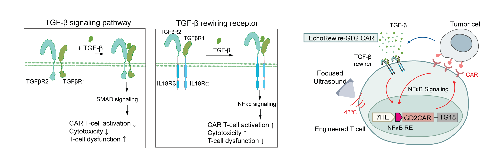
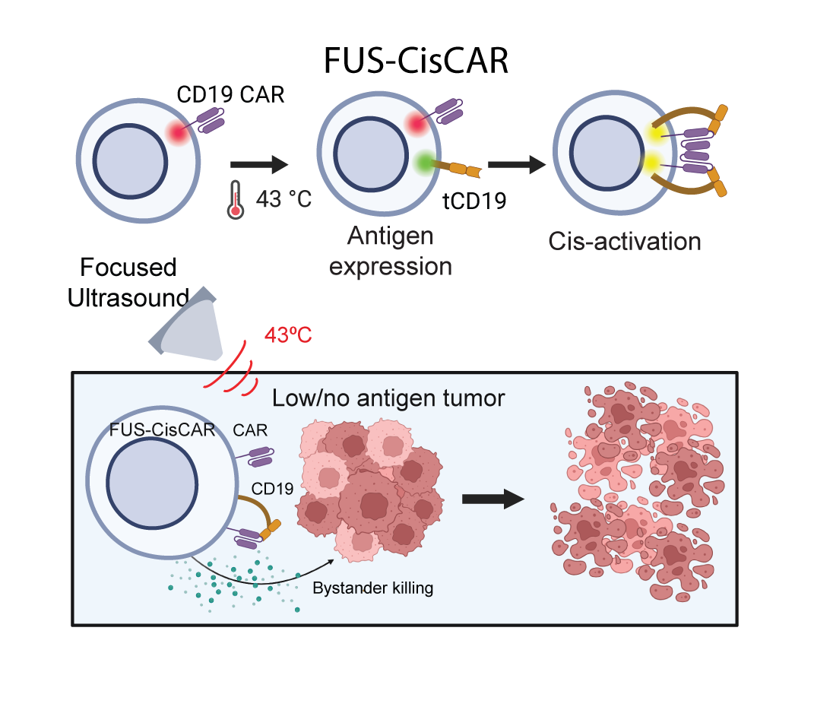

My research integrates quantitative imaging, molecular engineering, and external control to understand cellular processes and develop programmable therapies. Explore four major research stories below.

::: {.research-grid}

### [GLIDRE: Live-cell imaging of locus-specific DNA repair](research/glidre.qmd)
::: {.research-card}

A CRISPR–ELP platform enables time-resolved imaging of genomic loci and DNA repair-associated responses, revealing chromatin-state-dependent dynamics.

[{fig-alt="GLIDRE DNA repair imaging schematic and time-lapse"}](research/glidre.qmd)

[Read the research story →](research/glidre.qmd)
:::

::: {.research-card}

### [PDbody: Engineering selective molecular recognition](research/pdbody.qmd)

Directed evolution produces a PD-L1-binding monobody with enhanced recognition at lower pH, subsequently combined with a SynNotch-gated cellular therapy.

[{fig-alt="Directed evolution of the PDbody monobody"}](research/pdbody.qmd)

[Read the research story →](research/pdbody.qmd)
:::

::: {.research-card}

### [EchoRewire: Converting suppression into activation](research/echorewire.qmd)

Modular receptors convert inhibitory TGF-β signaling into stimulatory pathways, while focused ultrasound and feedback enable durable local CAR activity.

[{fig-alt="EchoRewire CAR-T ultrasound feedback concept and results"}](research/echorewire.qmd)

[Read the research story →](research/echorewire.qmd)
:::

::: {.research-card}
### [CisCAR: Ultrasound-controlled T-cell self-activation](research/ciscar.qmd)

CAR T cells express their cognate antigen in response to local thermal stimulation, enabling antigen-independent bystander cytotoxicity.

[{fig-alt="FUS-CisCAR bystander tumor killing schematic and results"}](research/ciscar.qmd)

[Read the research story →](research/ciscar.qmd)
:::

:::
