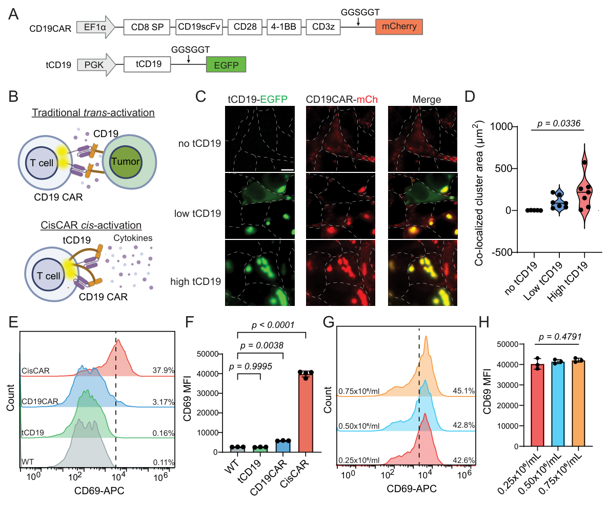
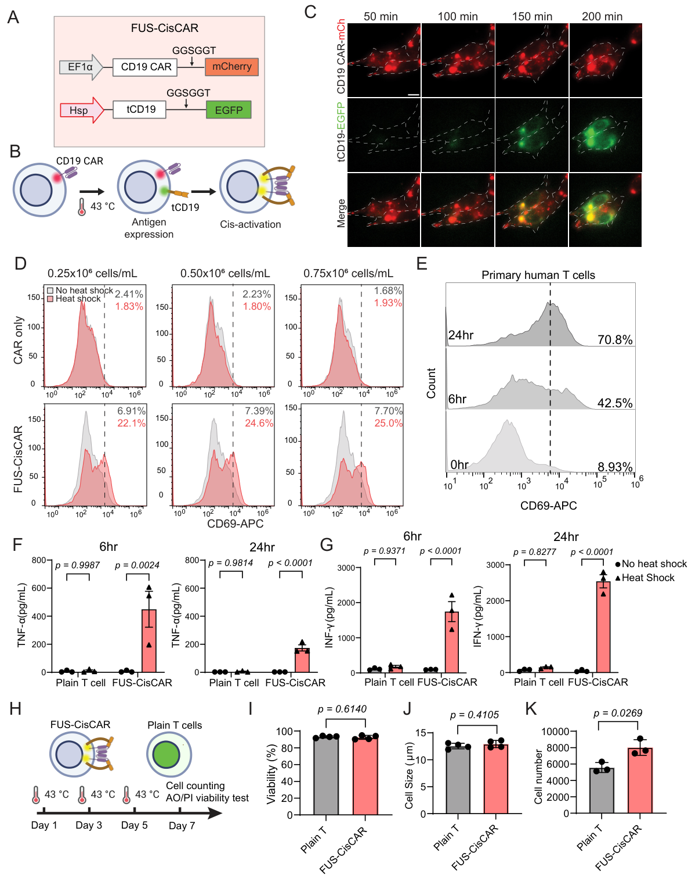
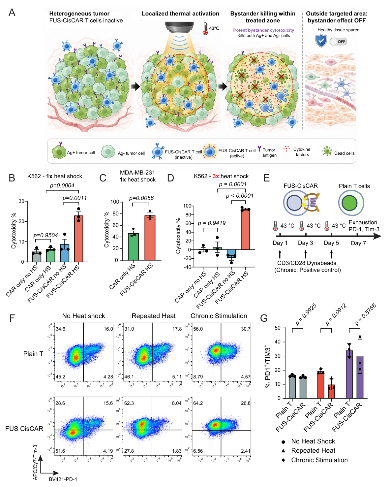
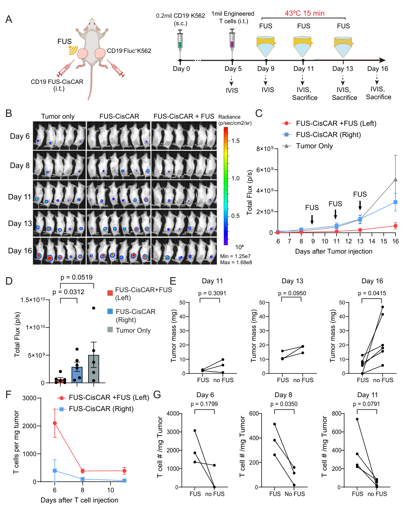

[← All research highlights](../projects.qmd)

**Research theme:** Engineer + Control — cis-activation and focused ultrasound  
**Publication:** *Molecular Therapy Oncology* (2026) · [Journal article](https://doi.org/10.1016/j.omton.2026.201323)

## The challenge

Tumor antigen heterogeneity and antigen escape limit durable CAR T-cell activity. CisCAR explores a different activation mechanism: engineering T cells to display the cognate antigen that activates their own CAR, then placing antigen expression under external thermal control.

## Discovery 1 — CARs respond to antigen presented in cis

{.research-figure}

**Approach.** Cells coexpressing truncated CD19 and CD19 CAR were assessed for receptor colocalization and CD69 activation.

**Key finding.** Antigen presentation on the same cell promoted CAR-associated clustering and T-cell activation, supporting cis-activation as an engineered signaling mechanism.

## Discovery 2 — Thermal control enables on-demand activation

{.research-figure}

**Approach.** A heat-responsive promoter drives tCD19 expression, whereas the CAR is constitutively expressed. Localized heating serves as the trigger for self-activation.

**Key finding.** Induction promoted CD69 expression and inflammatory cytokine secretion in engineered T cells, while the investigated repeated-stimulation conditions did not show evidence of significant fratricide.

## Discovery 3 — Activated CisCAR cells kill antigen-negative tumors

{.research-figure}

**Approach.** Thermal stimulation was applied to FUS-CisCAR cocultures containing antigen-negative tumor cells.

**Key finding.** Induced activation supported bystander killing of antigen-negative cells in the tested models, addressing an important dimension of tumor antigen escape.

## Discovery 4 — Focused ultrasound enables local tumor control in vivo

{.research-figure}

**Approach.** FUS was applied to selected tumor sites in a bilateral mouse model after FUS-CisCAR delivery.

**Key finding.** Ultrasound-treated tumors showed improved local control compared with contralateral untreated sites in the reported experiment, supporting a strategy for spatially regulated antigen-independent cytotoxicity.

## Why it matters

CisCAR links an unconventional engineered immune-cell activation mechanism to a noninvasive external trigger, offering a way to confine therapeutic activity to selected tissue regions even when tumor cells lack the canonical target antigen.
