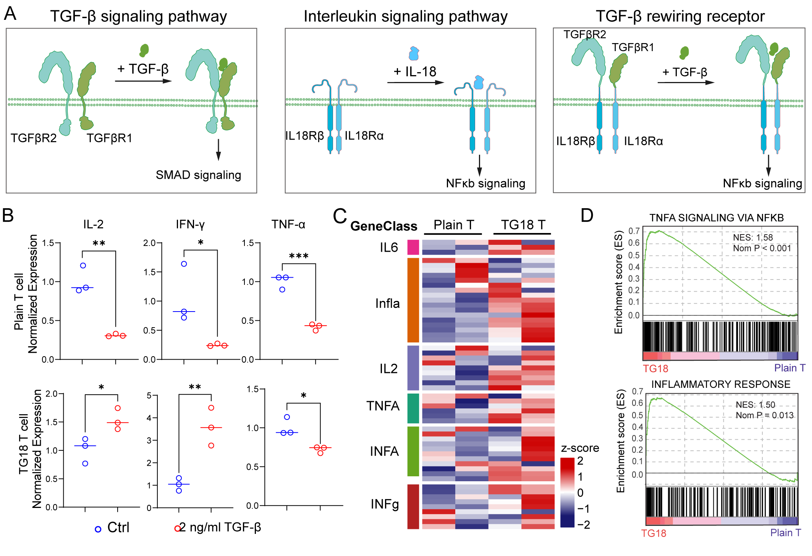
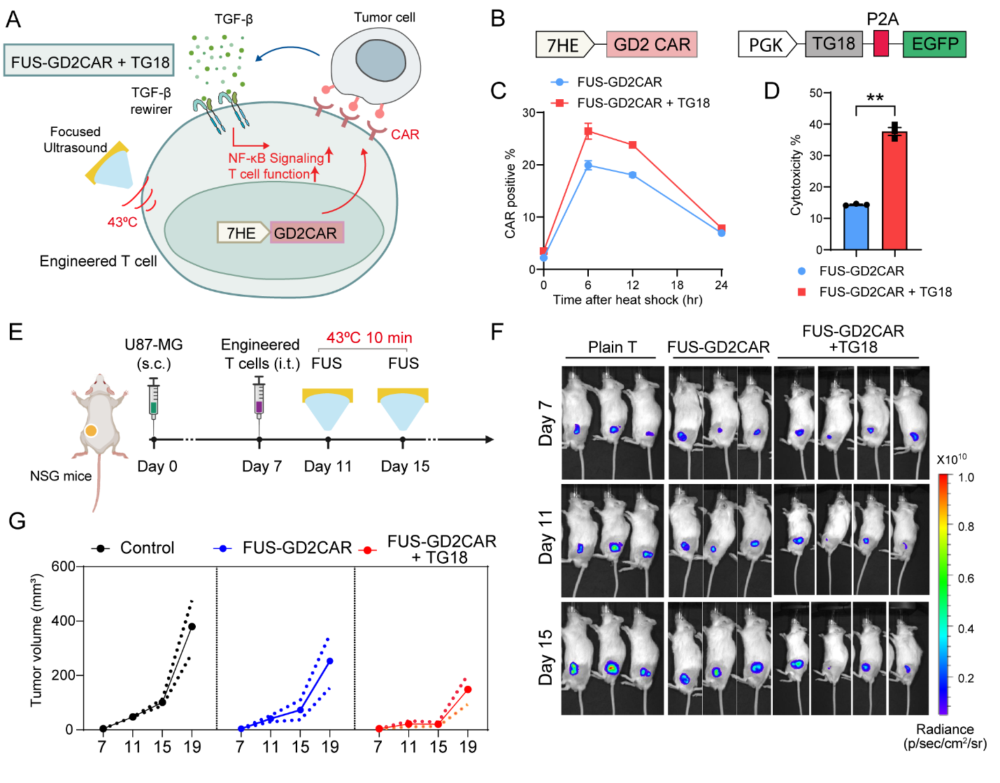

[← All research highlights](../projects.qmd)

**Research theme:** Engineer + Control — synthetic signaling and ultrasound  
**Manuscript status:** *Cell stem cell*, under revision.

## The challenge

The solid tumor microenvironment can suppress T-cell responses through factors such as TGF-β. Meanwhile, externally induced CAR expression can be transient. EchoRewire was developed to combine localized initiation with a microenvironment-driven mechanism for sustaining therapeutic activity.

## Discovery 1 — Redirecting TGF-β into stimulatory signals

{.research-figure}

**Approach.** Chimeric receptors couple TGF-β-binding ectodomains to interleukin receptor signaling modules. The TG18 design redirects TGF-β stimulation toward the IL-18–MyD88–NFκB pathway.

**Key finding.** TG18 converts an inhibitory extracellular cue into pro-activation signaling, altering inflammatory and effector-associated responses in engineered T cells.

## Discovery 2 — Integrating focused ultrasound and feedback

{.research-figure}

**Approach.** FUS initiates localized CAR expression; rewirer-mediated TGF-β signaling then supports sustained activation through a positive feedback design.

**Key finding.** The integrated system demonstrated enhanced and more durable antitumor responses in vivo.

## Why it matters

EchoRewire treats the immunosuppressive tumor environment not only as a barrier but as a programmable input for therapeutic cells, while preserving a spatially targeted ultrasound initiation step.
