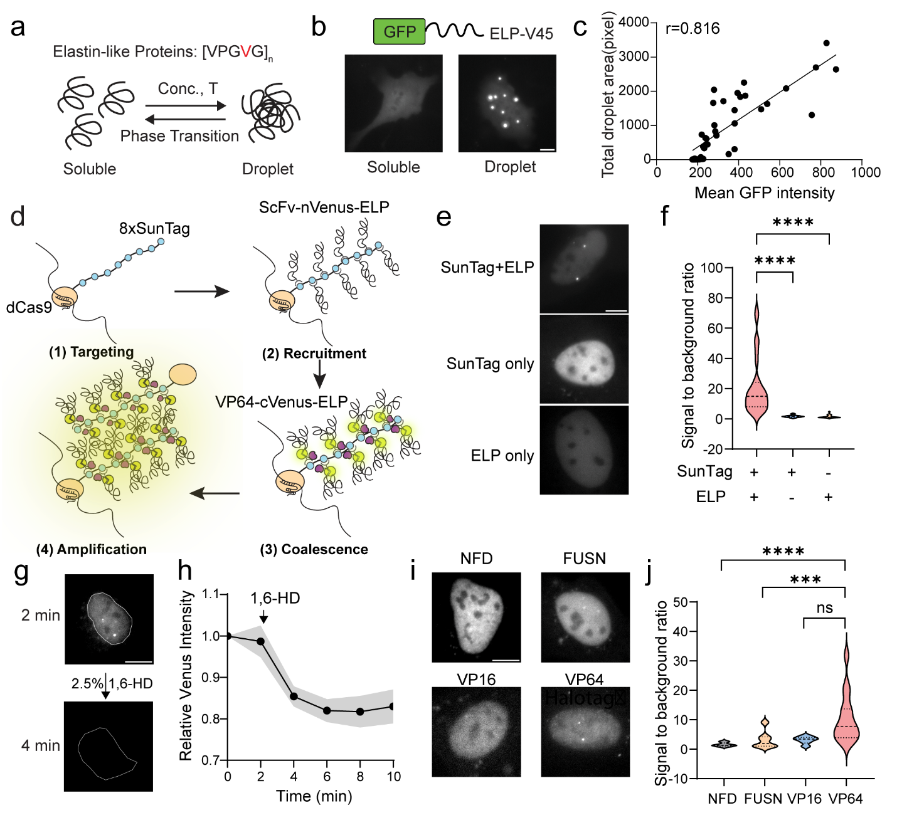
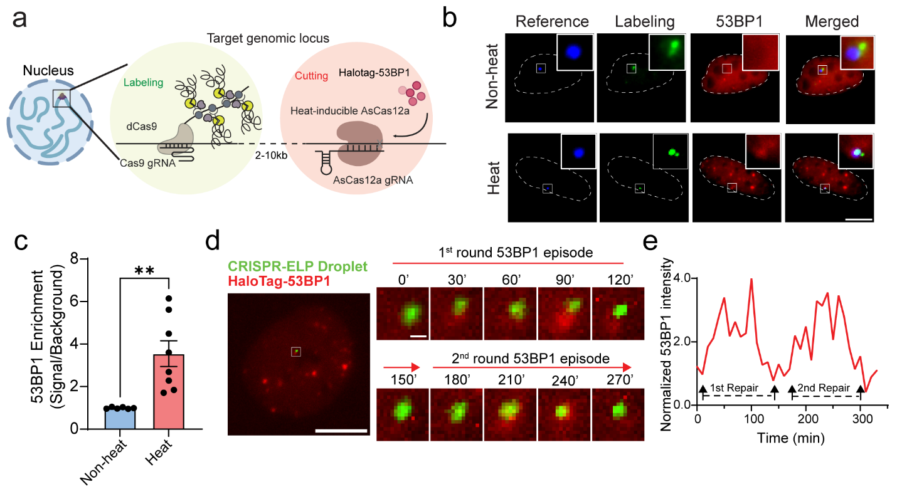
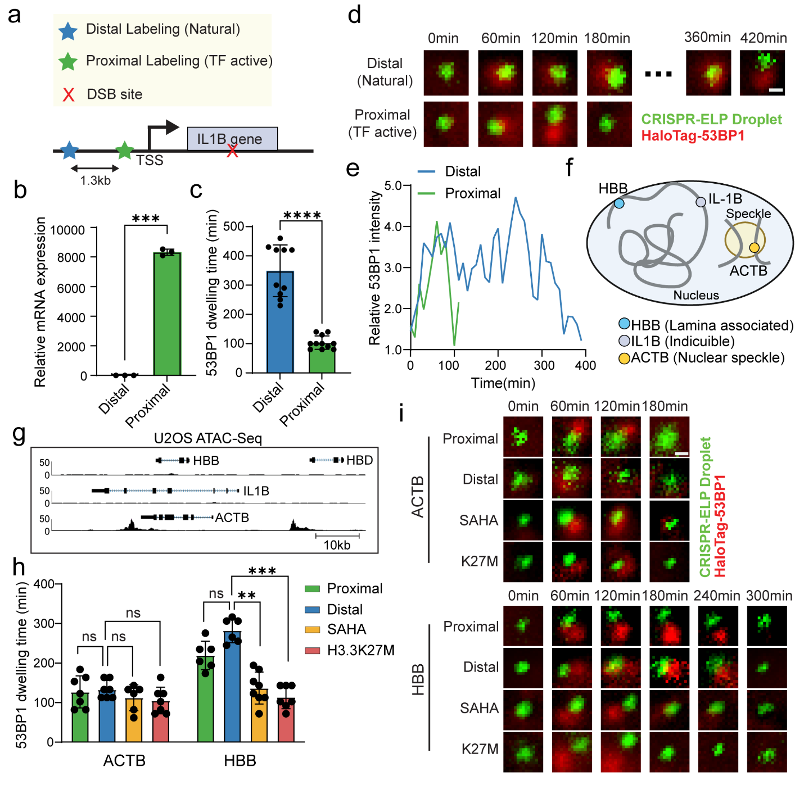
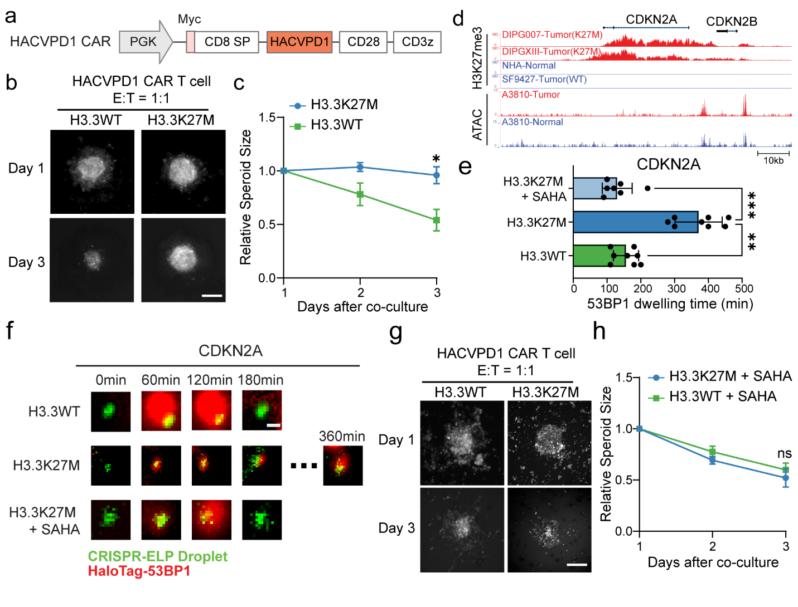

[← All research highlights](../projects.qmd)

**Research theme:** Observe — live-cell molecular imaging and DNA repair  
**Manuscript status:** Under revision (confirm public disclosure before publishing figures)

## The challenge

Traditional DNA damage assays provide valuable endpoints but have difficulty tracking the damage response at a *defined, non-repetitive genomic locus* in the same living cell over time. GLIDRE (Genomic Locus Imaging and DSB Repair Monitoring by Elastin-like Proteins) was developed to provide locus-specific visualization combined with a dynamic repair-associated readout.

## Discovery 1 — Amplifying signals at non-repetitive genomic loci

{.research-figure}

**Approach.** Engineered dCas9–SunTag complexes recruit elastin-like protein assemblies to the genomic target. Condensate-associated signal amplification makes non-repetitive loci accessible to live-cell observation.

**Key finding.** The strategy provides an optical handle for following specified genomic sites and pairing locus tracking with induced DNA damage.

## Discovery 2 — Measuring local DNA damage responses in real time

{.research-figure}

**Approach.** Orthogonal AsCas12a induces DNA double-strand breaks near labeled loci, while recruitment and residence of the DNA damage response factor 53BP1 are monitored in living cells.

**Key finding.** GLIDRE supports time-resolved, locus-specific assessment of repair-*associated* dynamics. Importantly, 53BP1 residence is a proxy for the response rather than a direct measurement of completed repair.

## Discovery 3 — Chromatin state influences repair-associated kinetics and therapy response

{.research-figure}

{.research-figure}

**Key finding.** More accessible chromatin generally exhibited shorter 53BP1 residence than compacted chromatin, with transcription contributing in a context-dependent manner. In engineered H3.3K27M U2OS models, altered locus-specific dynamics accompanied reduced CAR T-cell response; SAHA treatment shifted the observed dynamics and increased spheroid sensitivity.

## Live imaging video

*Video placeholder:* when your GLIDRE video is available, put a compressed `.mp4` in `research/videos/` and embed it here:

```{=html}
<!-- Replace the placeholder below only after adding the actual video file:
<video controls preload="metadata" playsinline width="100%">
  <source src="videos/glidre.mp4" type="video/mp4">
  Your browser does not support video playback.
</video>
-->
```

## Why it matters

GLIDRE connects molecular imaging with a functional, chromatin-aware view of the DNA damage response, providing a framework for testing how local genomic context influences cellular resilience and treatment response.
