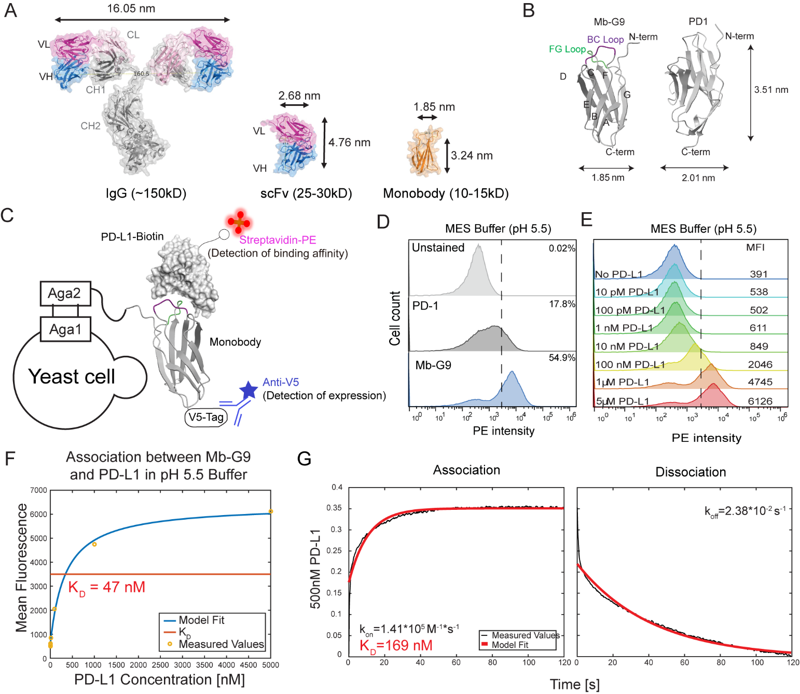
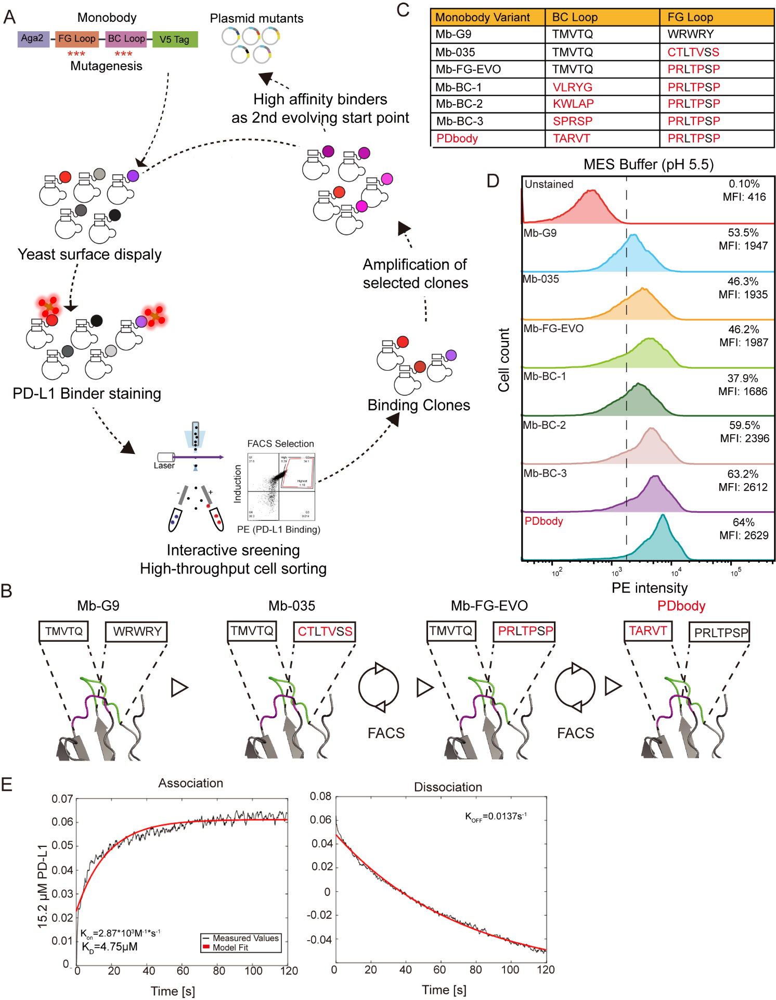
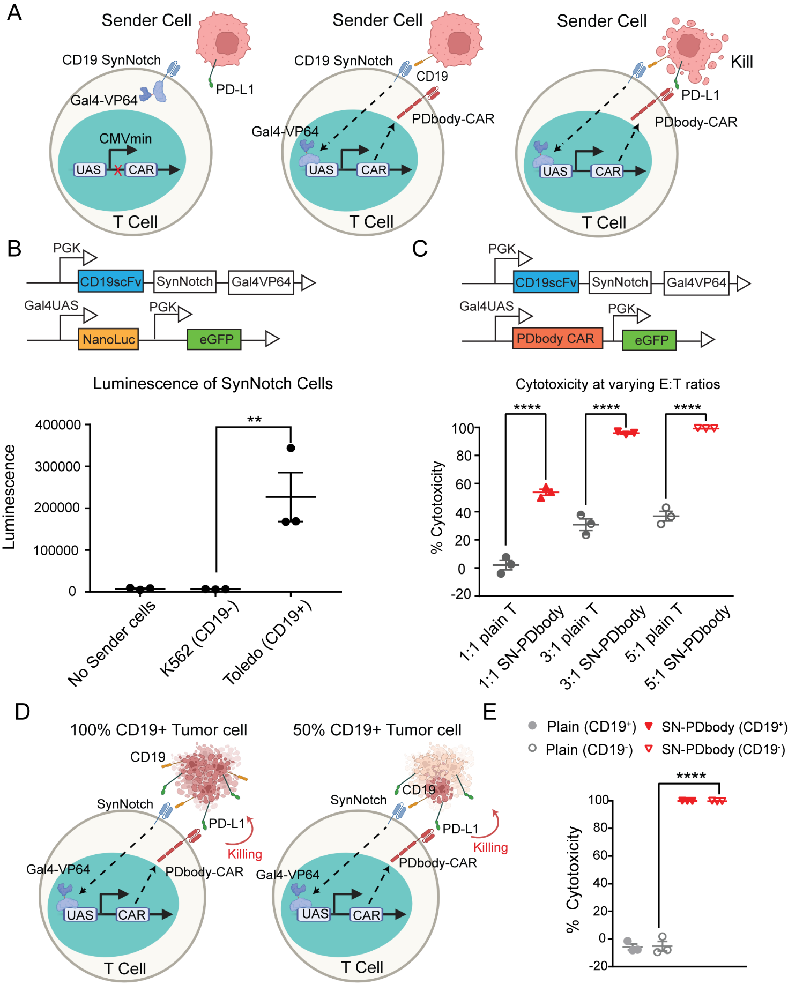
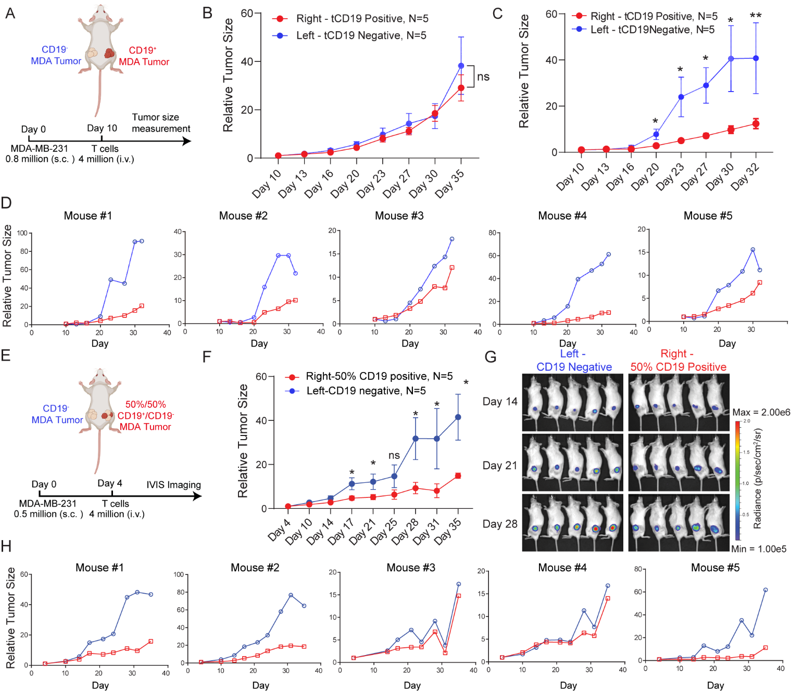

[← All research highlights](../projects.qmd)

**Research theme:** Engineer — molecular recognition and conditional cell therapy  
**Publication:** *ACS Nano* (2024) · [Journal article](https://doi.org/10.1021/acsnano.4c01597)

## The challenge

PD-L1 is abundant in many tumors but also appears on healthy cells, creating risks for therapies that recognize PD-L1 indiscriminately. We asked whether a human-derived monobody scaffold could be engineered for preferential recognition under tumor-like acidic conditions and paired with an additional antigen-dependent safety gate.

## Discovery 1 — Developing a PD-L1-binding scaffold

{.research-figure}

**Approach.** A human fibronectin type III-derived monobody scaffold was evaluated for PD-L1 recognition, including its pH-dependent binding behavior.

**Key finding.** Monobody–PD-L1 interaction was sensitive to assay conditions, motivating protein engineering aimed at binding under mildly acidic tumor-relevant conditions.

## Discovery 2 — Directed evolution improves recognition

{.research-figure}

**Approach.** Rational design was combined with yeast display and successive directed-evolution libraries targeting monobody binding loops.

**Key finding.** The evolved PDbody provided a PD-L1-recognizing module suitable for integration into an engineered receptor system, with preferential binding under the lower-pH conditions evaluated.

## Discovery 3 — Building a gated cellular therapy

{.research-figure}

{.research-figure}

**Approach.** A CD19-recognizing SynNotch circuit was used to induce PDbody-based CAR expression, requiring a priming antigen before PD-L1-directed effector activity.

**Key finding.** The engineered T cells achieved conditional recognition and antitumor activity in the investigated breast-cancer models, supporting combinatorial strategies to improve spatial specificity.

## Why it matters

PDbody illustrates a design-build-test approach spanning protein engineering, receptor design, and cellular therapy, with multiple layers of conditional recognition.
